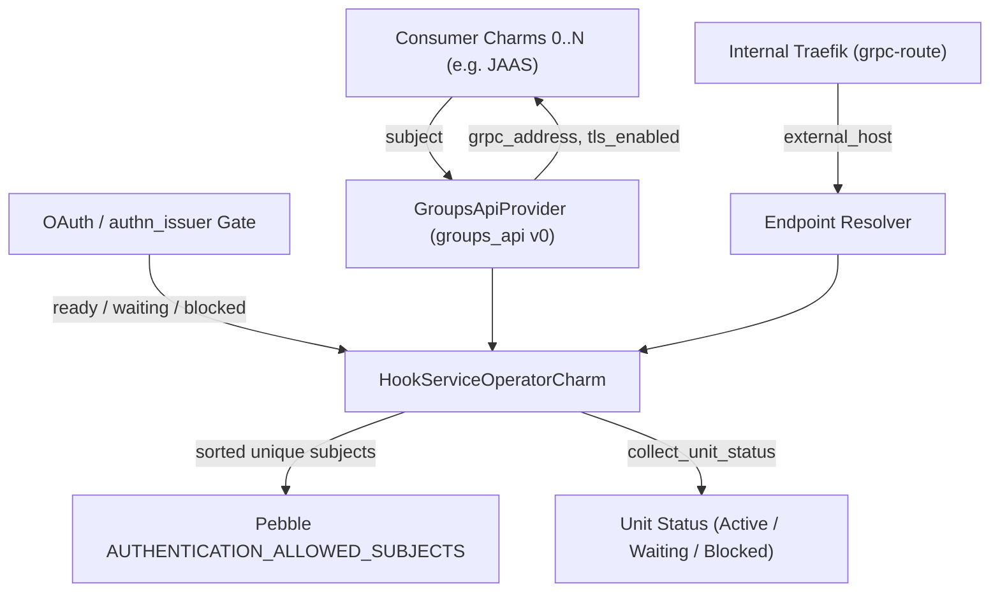

# Design

## Context

See `proposal.md` (`Why`) for problem motivation.

The charm already exposes TCP port `9090` and optional Traefik TLS routing via `grpc-route` (`GrpcRouteIntegration` in `src/integrations.py`). Meanwhile, `OAuthIntegration.get_oauth_provider_data()` (`src/integrations.py:383-411`) builds `AUTHENTICATION_ALLOWED_SUBJECTS` from `authn_allowed_subjects` and `oauth.client_id` only when `oauth` is ready or `authn_issuer` is set. `use_ingress_for_relations` remains strictly scoped to HTTP endpoints (`_hydra_hook_url`).

External consumers such as JAAS (`jimm-k8s-operator`, `ubuntu@22.04` / Python 3.10 / Pydantic v2) need a `v0` charm library under `lib/charms/hook_service/v0/` to send an OIDC `subject` ID and consume `{grpc_address, tls_enabled}`.

## Architecture Diagram

## Goals / Non-Goals

**Goals:**
- Define `lib/charms/hook_service/v0/groups_api.py` (`GroupsApiProvider`, `GroupsApiRequirer`, Pydantic v2 databag models) compatible with Python 3.10+.
- Reconcile `groups-api` endpoint publication and `AUTHENTICATION_ALLOWED_SUBJECTS` idempotently inside `_holistic_handler`.
- Enforce JWT authentication readiness whenever `groups-api` has active relations, without changing behavior when `groups-api` is absent.

**Non-Goals:**
- Supporting Charmhub `charmcraft publish-lib` registration (Charmhub-hosted libraries are deprecated; generate a valid UUIDv4 `LIBID`).
- Adding Phase 2 Istio `istio-ingress-route` (`GRPCRoute`) resolution (can extend the resolver in Phase 2 without breaking `groups_api` v0).

## Decisions

### 1. Standalone `v0` library in `lib/charms/hook_service/v0/groups_api.py`

Create `GroupsApiProvider` and `GroupsApiRequirer` using Pydantic `BaseModel` databag schemas (`RequirerData(subject: str)` and `ProviderData(grpc_address: str, tls_enabled: StrictBool)`), matching `sts_info.py` boolean serialization (`"true"` / `"false"`). Set `LIBAPI = 0`, `LIBPATCH = 1`, and a generated UUIDv4 `LIBID`.

- **Rationale:** `tox.ini`, `pyproject.toml`, and `.github/workflows/release_libs.yaml` already target `lib/charms/hook_service/**`. Separating `tls_enabled` from `grpc_address` (`host:9090`) matches `grpc.NewClient` in Go and avoids Traefik `scheme: "http"` ambiguity on `:9090` (where Traefik always terminates TLS).
- **Alternatives considered:**
  - *Single URL field (`https://host:9090` vs `http://host:9090`)*: Rejected because `grpc-go` rejects HTTP schemes on dial targets unless stripped, and Traefik's `scheme` key can report `"http"` even while `:9090` terminates TLS.
  - *Registering via `charmcraft create-lib`*: Rejected because Charmhub libraries are deprecated and Charmhub auth is unnecessary.

### 2. Endpoint resolution by `grpc-route` presence, reading `model.get_relation` directly

Resolve `(grpc_address, tls_enabled)` in `src/integrations.py` (`GroupsApiIntegration` / helper) by checking `charm.model.get_relation(GRPC_ROUTE_INTEGRATION_NAME)` directly:
- No active `grpc-route` relation -> `(f"{app}.{model}.svc.cluster.local:{GRPC_PORT}", False)`
- Active `grpc-route` relation with non-empty `external_host` -> `(f"{external_host}:{GRPC_PORT}", True)`
- Active `grpc-route` relation with empty `external_host` -> return `None` (withhold write and report `WaitingStatus`)

- **Rationale:** `TraefikRouteRequirer.external_host` stores `external_host` in `StoredState` and only clears it in `_on_relation_broken` (not when cleared upstream). Reading `relation.data[relation.app].get("external_host", "")` matches `InternalIngressData._external_host()` and stays always-current. Holding off writes when `grpc-route` lacks `external_host` prevents leaking `.svc.cluster.local` to cross-cluster JAAS units.
- **Alternatives considered:** Gating on `use_ingress_for_relations`. Rejected per requirement because `use_ingress_for_relations` stays HTTP-only.

### 3. Auth gate when `groups-api` is active

Update `authentication_config_status(charm)` in `src/utils.py` (or add a dedicated check called alongside it in `_on_collect_status` and `_holistic_handler`):
- If no active `groups-api` relations exist: keep existing behavior (`ActiveStatus()` when no auth is set).
- If at least one active `groups-api` relation exists:
  - If `charm.oauth_integration.is_ready()` or `authn_issuer` is set: `ActiveStatus()`.
  - Else if `charm.model.get_relation(OAUTH_INTEGRATION_NAME)` exists (pending OAuth client creation): `WaitingStatus("Waiting for OAuth integration readiness")` and withhold `groups-api` databag writes.
  - Else: `BlockedStatus("Missing authentication configuration for groups-api")` and withhold `groups-api` databag writes.

- **Rationale:** `hook-service` falls back to `NewNoopVerifier()` when `AUTHENTICATION_ENABLED=false`. Withholding `groups-api` databag publication until auth is active ensures JAAS never receives an endpoint pointing at an unauthenticated gRPC server, while avoiding breaking existing deployments that do not use `groups-api`.
- **Alternatives considered:** Leaving `groups-api` usable without auth. Rejected for security: `grpc-route` exposes `:9090` externally and would expose all group mappings without JWT checks.

### 4. Deterministic multi-consumer subject merge and departure cleanup

`GroupsApiProvider` reads `subject` from every active relation (`rel.active and rel.app`), ignoring empty/missing values. `HookServiceOperatorCharm._pebble_layer` passes sorted, deduplicated subjects into `OAuthIntegration.get_oauth_provider_data(..., extra_subjects=...)` (or merges before rendering), producing a stable comma-separated `AUTHENTICATION_ALLOWED_SUBJECTS` string. Observing `relation_changed`, `relation_broken`, and `relation_departed` ensures departing units' subjects are removed promptly.

- **Rationale:** Sorting and deduplicating prevents non-deterministic Pebble layer diffs and avoids unnecessary `hook-service` restarts across multi-unit or multi-consumer updates.
- **Alternatives considered:** Limiting `groups-api` to `limit: 1`. Rejected because multiple internal/external services may consume `GroupsMappingService`.

### 5. Component Touchpoints

- `charmcraft.yaml`: Add `provides.groups-api` (`interface: groups_api`, optional, no limit).
- `terraform/outputs.tf`: Add `groups-api = "groups-api"` to `output "provides"`.
- `lib/charms/hook_service/v0/groups_api.py`: New `v0` library (`GroupsApiProvider`, `GroupsApiRequirer`, `GroupsApiProviderData`, `GroupsApiRequirerData`, events).
- `src/constants.py`: Add `GROUPS_API_INTEGRATION_NAME = "groups-api"`.
- `src/integrations.py`: Add `GroupsApiIntegration` wrapper and extend `OAuthProviderData` / `OAuthIntegration` subject merging.
- `src/utils.py`: Update `authentication_config_status` (and add `groups_api_integration_exists` / `grpc_route_waiting` helpers if needed) for `_on_collect_status`.
- `src/charm.py`: Instantiate `GroupsApiProvider` / `GroupsApiIntegration`, observe `groups-api` events, call `_ensure_groups_api_relation` in `_holistic_handler`, pass merged subjects into `_pebble_layer`, and surface `WaitingStatus`/`BlockedStatus` in `_on_collect_status`.

## Database Schema Modifications

This change introduces no database tables, indexes, or migrations.

## System Considerations

- **Security:** Enforcing `oauth` or `authn_issuer` whenever `groups-api` is active guarantees `JwtVerifier` (`AUTHENTICATION_ENABLED=true`) protects `GroupsMappingService`. Only explicitly related consumers' OIDC subjects are added to `AUTHENTICATION_ALLOWED_SUBJECTS`.
- **Performance:** Pebble replan runs only when the sorted deduplicated `AUTHENTICATION_ALLOWED_SUBJECTS` string actually changes.
- **Observability:** Existing Pebble layer diffs and Juju unit status messages surface blocked/waiting auth or `grpc-route` readiness states clearly.
- **Scalability:** One-to-many `groups-api` relations iterate over `model.relations["groups-api"]` with `O(N)` work for N consumers; only the leader writes provider databags.

## Risks / Trade-offs

- **[Traefik `external_host` update latency]** -> While `grpc-route` waits for Traefik to publish `external_host`, `groups-api` stays in `WaitingStatus` and withholds endpoint data. Trade-off accepted to guarantee remote JAAS units never cache a cluster-local `.svc.cluster.local` target.
- **[Shared `AUTHENTICATION_ALLOWED_SUBJECTS` across HTTP and gRPC]** -> `hook-service` uses a single `AUTHENTICATION_ALLOWED_SUBJECTS` list for both `:8080` REST authz endpoints and `:9090` gRPC. Consumer subjects added via `groups-api` are therefore also accepted by JWT-authenticated HTTP endpoints on `:8080` if the token matches the issuer. Documented clearly as current workload behavior.
- **[Pebble restart on consumer join/leave]** -> Updating `AUTHENTICATION_ALLOWED_SUBJECTS` restarts `hook-service` via Pebble replan, briefly interrupting active gRPC streams; consumers must rely on gRPC reconnect/retry.

## Migration Plan

1. Add `groups-api` metadata, `v0` library, integration logic, and unit/integration tests.
2. Existing deployments without `groups-api` upgrade without config changes or auth blockers.
3. For JAAS integration, integrate `hook-service:oauth` (or set `authn_issuer`), optionally integrate `hook-service:grpc-route` with internal Traefik, and relate `hook-service:groups-api` with JAAS.
