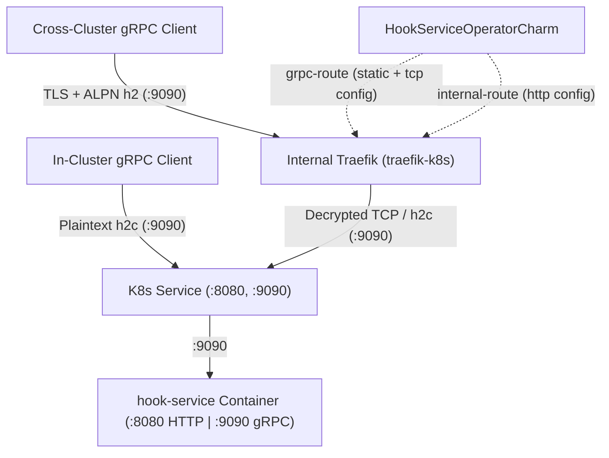

# Design

## Context

See `proposal.md` (`Why`) for problem motivation.

The `hook-service` binary starts an HTTP server on port `8080` and a plaintext HTTP/2 (`h2c`) gRPC server on port `9090`. `WorkloadService.open_port()` in `src/services.py` already opens TCP ports `8080` and `9090` (landed in `f6ba1cda3` prior to this change), and `internal-route` configures HTTP routers only. The gRPC server only exists in workload images `>= v1.4.0`; the image bump is carried by the stacked upgrade PR (#255), not this change.

`HookServiceOperatorCharm` reconciles all integrations through `_holistic_handler` in `src/charm.py` and includes `charms.traefik_k8s.v0.traefik_route`.

## Architecture Diagram

## Goals / Non-Goals

**Goals:**
- Expose TCP port `9090` on the unit and Kubernetes Service without changing container startup flags or Pebble environment variables.
- Encapsulate `grpc-route` Traefik integration in `src/integrations.py` and render dynamic TCP config from `templates/grpc-route.json.j2`.
- Drive `grpc-route` submission idempotently from `_holistic_handler` on the leader unit.

**Non-Goals:**
- Publishing the resolved gRPC URL to downstream charms (handled in the follow-up `groups-api` change).
- Managing TLS certificates inside the `hook-service` workload container.

## Decisions

### 1. Add a dedicated `grpc-route` relation instead of extending `internal-route`

The charm adds a separate `grpc-route` endpoint (`interface: traefik_route`, `limit: 1`, `optional: true`) with its own `GrpcRouteIntegration` wrapper and `templates/grpc-route.json.j2` template.

- **Rationale:** Operators can opt into gRPC exposure independently and route gRPC through a separate internal Traefik instance if needed. It also avoids breaking `InternalIngressData.load()`, which returns an empty config until Traefik sets `external_host`.
- **Alternatives considered:** Extending `internal-route` to emit both `http` and `tcp` blocks. We rejected this because every `internal-route` relation would force a Traefik static config restart to open port `9090`.

### 2. Use a dedicated `:9090` TCP entrypoint with `tls.passthrough: false`

`GrpcRouteIntegration` submits static config `{"entryPoints": {"grpc": {"address": ":9090"}}}` and a TCP router on `["grpc"]` with `rule: "HostSNI('*')"`, `tls: {"passthrough": false}`, and no `proxyProtocol`.

- **Rationale:** `traefik-k8s` reads `static.entryPoints` and opens `ServicePort(9090)` on its LoadBalancer Service. A dedicated entrypoint avoids Traefik v2.11 priority rules on `websecure` (`:443`), where `PathPrefix` HTTPS routers override `HostSNI(*)` TCP routers. Traefik's default TLS options advertise `ALPN: ["h2", "http/1.1"]`, which satisfies `grpc-go` (`>= 1.67`) ALPN checks before forwarding raw `h2c` bytes.
- **Alternatives considered:** Routing gRPC through an HTTP router with `scheme: h2c` on `websecure`. We rejected this to match the proven `authentik-ldap-outpost-operator` L4 pattern requested for internal TCP ingress.

### 3. Omit `proxyProtocol` on the entrypoint and TCP service

Unlike `authentik-ldap-outpost-operator`, `templates/grpc-route.json.j2` and `static_config` omit `proxyProtocol`.

- **Rationale:** `hook-service` passes a standard `net.Listen("tcp", ":9090")` socket directly to `grpc.NewServer()`. Prepending PROXY protocol v2 bytes corrupts the HTTP/2 client preface (`PRI * HTTP/2.0`) and drops connections.
- **Alternatives considered:** Adding PROXY protocol v2 support to `hook-service`. We rejected this because JWT authentication handles caller identity and requires no client IP header at L4.

### 4. Use `TraefikRouteRequirer` with `raw=False`

`GrpcRouteIntegration` instantiates `TraefikRouteRequirer` with `raw=False` (default), matching `authentik-ldap-outpost-operator`.

- **Rationale:** With `raw=False`, `traefik-k8s` attaches its managed TLS certificate domain configuration for hostnames and omits `domains` for bare LoadBalancer IPs. Furthermore, the leader can submit `config` and `static` immediately on `relation-joined` before Traefik populates `external_host`.
- **Alternatives considered:** Setting `raw=True` and templating `tls.domains` with `external_host`. We rejected this because bare IP `external_host` values produce invalid wildcard SAN entries (`*.<ip>`).

### 5. Component Touchpoints

- `charmcraft.yaml` and `terraform/outputs.tf`: Declare `grpc-route`.
- `src/constants.py`: Define `GRPC_PORT = 9090` and `GRPC_ROUTE_INTEGRATION_NAME = "grpc-route"`.
- `src/services.py`: Update `WorkloadService.open_port()` to open `GRPC_PORT` alongside `PORT`.
- `templates/grpc-route.json.j2` and `src/integrations.py`: Render and submit TCP router and service config.
- `src/charm.py`: Observe `grpc-route` relation events (`ready` / `relation_joined` / `relation_changed` / `relation_broken`) and call `_ensure_grpc_ingress` inside `_holistic_handler`.

## Database Schema Modifications

This change introduces no database tables, indexes, or migrations.

## System Considerations

- **Security:** Traefik terminates TLS on an internal-only ingress controller, while cluster-internal traffic uses plaintext `h2c` between Traefik and the `hook-service` Service. Application-layer JWT verification (`GrpcInterceptor`) still authenticates gRPC streams.
- **Performance:** TCP proxying forwards HTTP/2 frames without L7 header parsing overhead and supports long-lived server-streaming RPCs (`GroupsMappingService`). `traefik-k8s` merges its standard entrypoint `readTimeout` settings into static TCP entrypoints.
- **Observability:** Existing Prometheus metrics (`/api/v0/metrics` on `:8080`) and OpenTelemetry tracing cover gRPC handlers inside `hook-service` without extra charm configuration.
- **Scalability:** Kubernetes `ClusterIP` balances L4 TCP connections across `hook-service` pods at connection establishment time rather than per RPC stream.

## Risks / Trade-offs

- **[Port `9090` wildcard collision on shared Traefik]** -> `HostSNI(*)` claims all TLS traffic on `:9090` for one Traefik instance. Deployments that expose multiple `:9090` gRPC services must use separate internal Traefik instances or add SNI domain routing later.
- **[Traefik restart on static config update]** -> Adding `static.entryPoints.grpc` triggers a one-time Traefik restart when `grpc-route` first connects. Keep `grpc-route` optional so unaffected deployments avoid restarts.
- **[L4 connection pinning across pods]** -> Long-lived HTTP/2 connections pin to one pod until reconnect. Acceptable for current internal consumer counts, with Phase 2 Istio `GRPCRoute` addressing L7 balancing later.

## Migration Plan

1. Upgrade the `hook-service` charm revision so `pebble-ready` opens TCP port `9090` without downtime.
2. Relate `hook-service:grpc-route` to the internal `traefik-k8s` application when cross-cluster gRPC ingress is needed.
3. Verify Traefik exposes port `9090` and completes TLS handshakes with `ALPN: h2`.
4. To roll back, remove the `grpc-route` relation and revert the charm revision.
